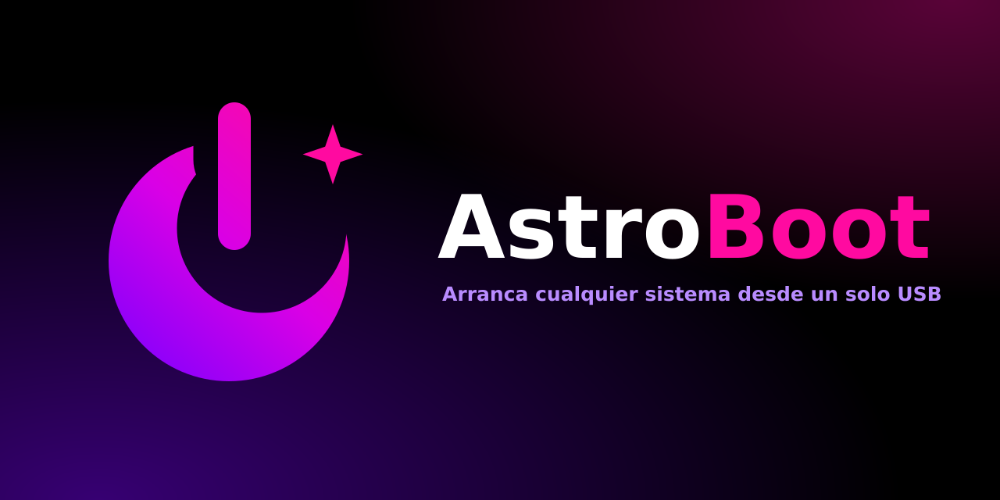
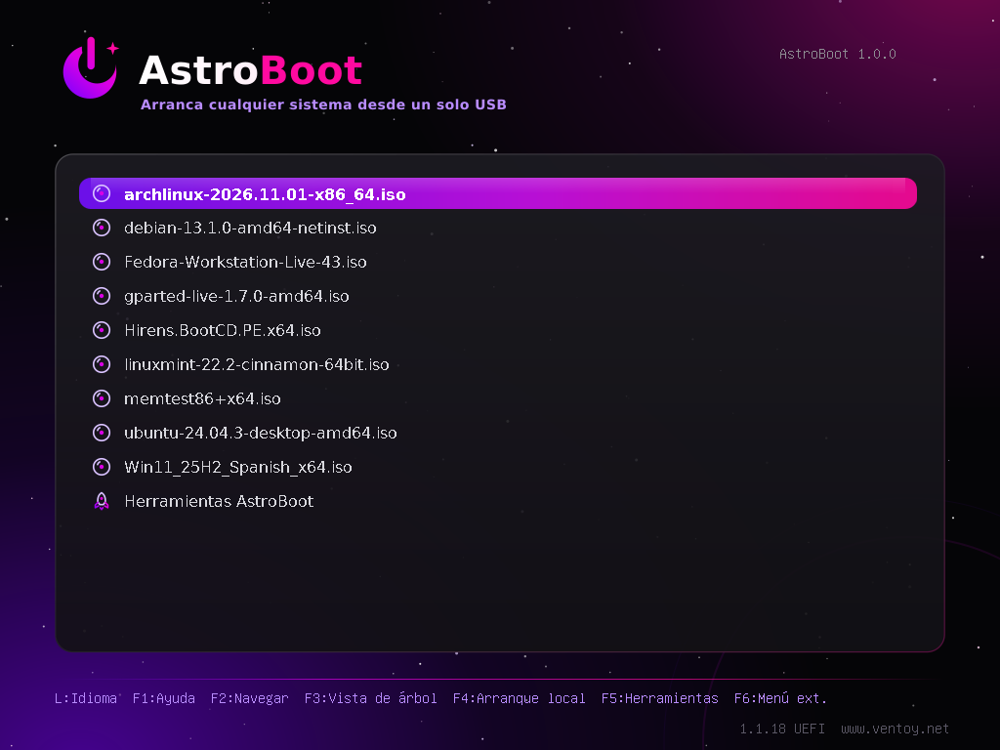
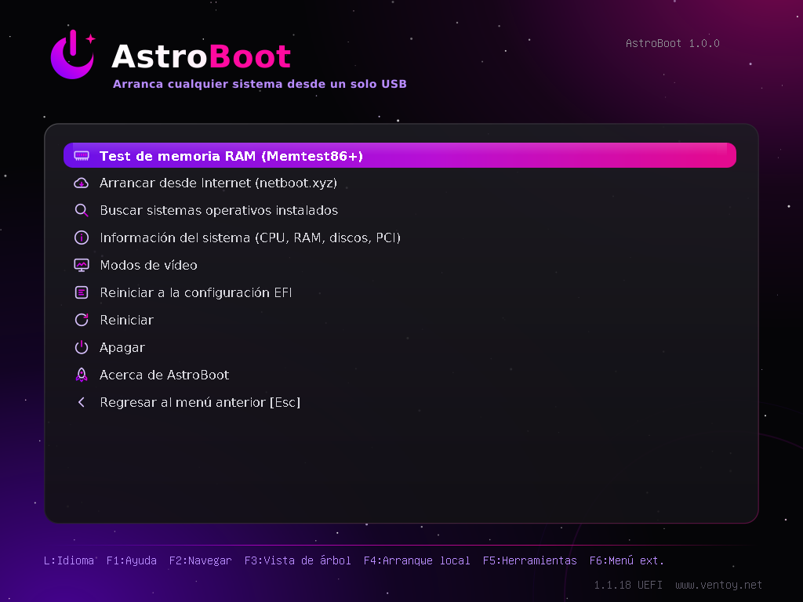
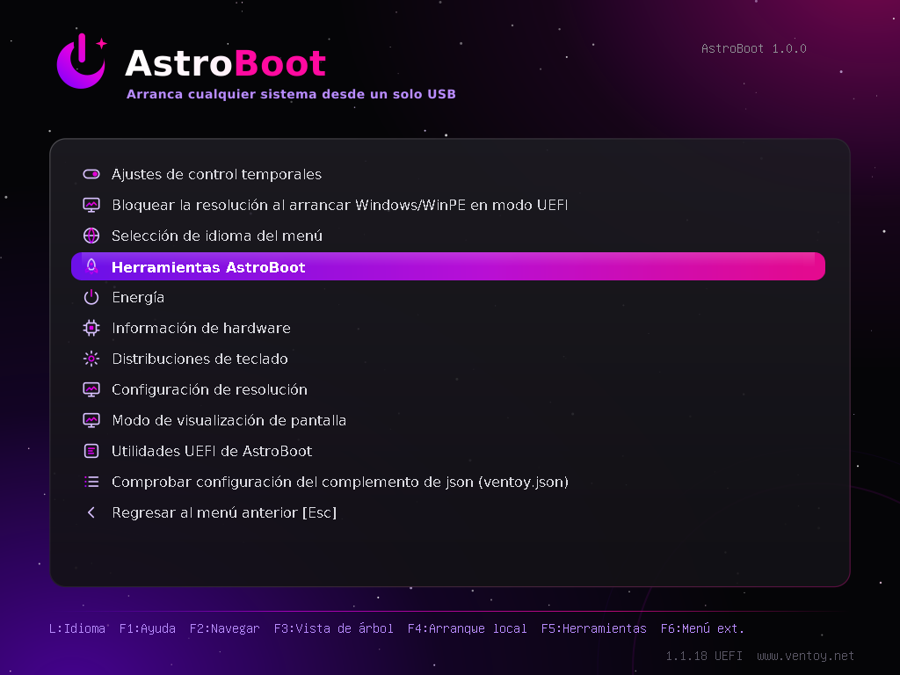
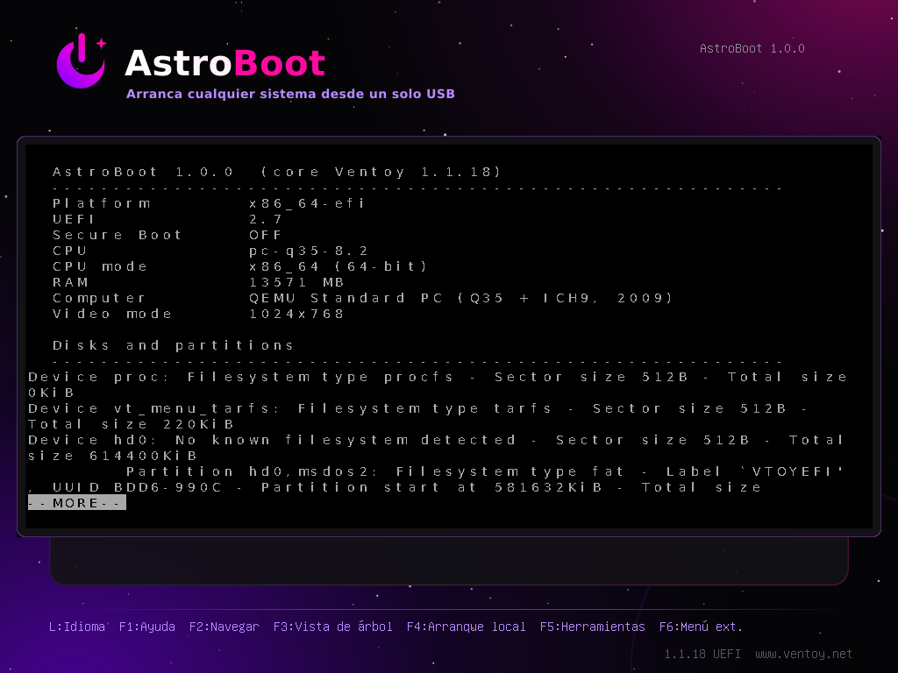
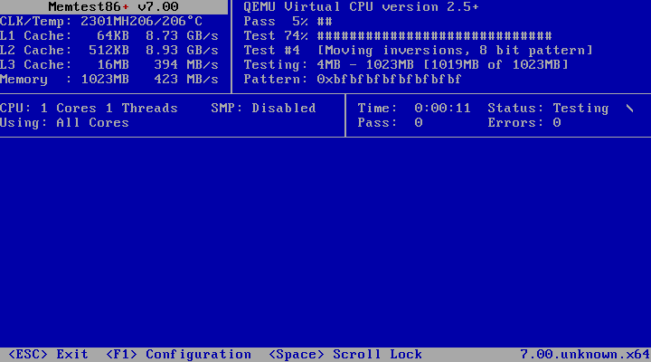
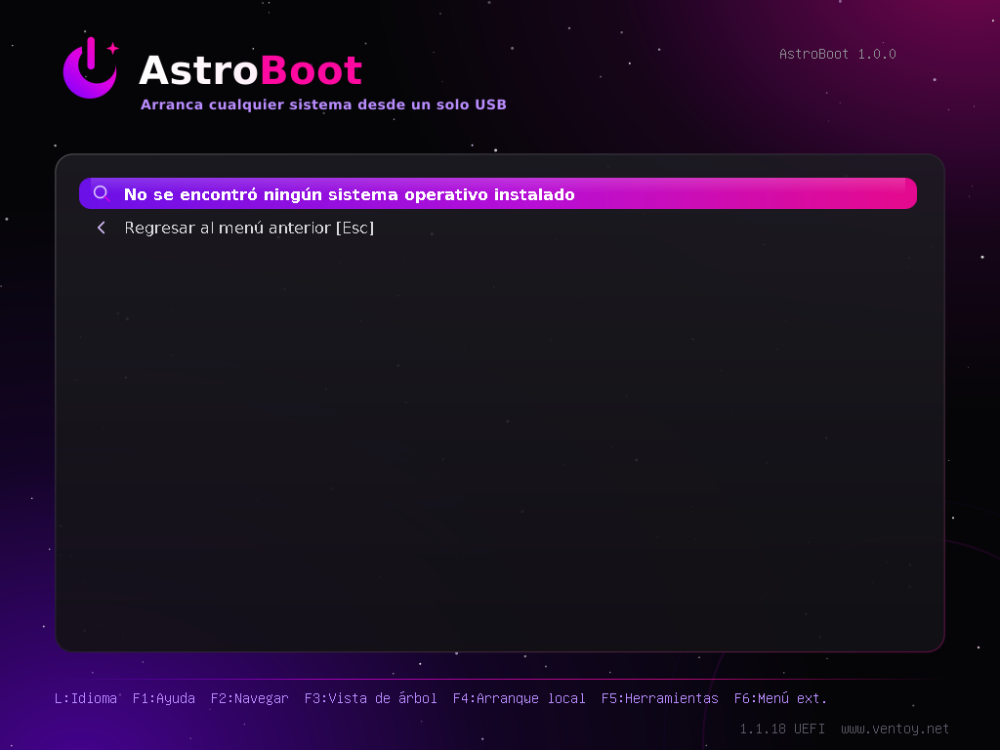
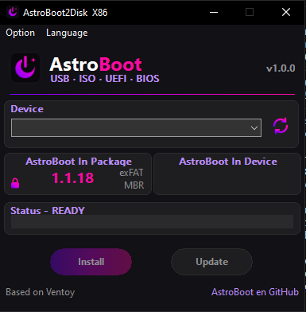
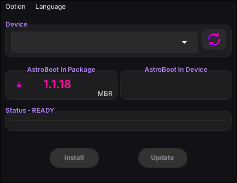
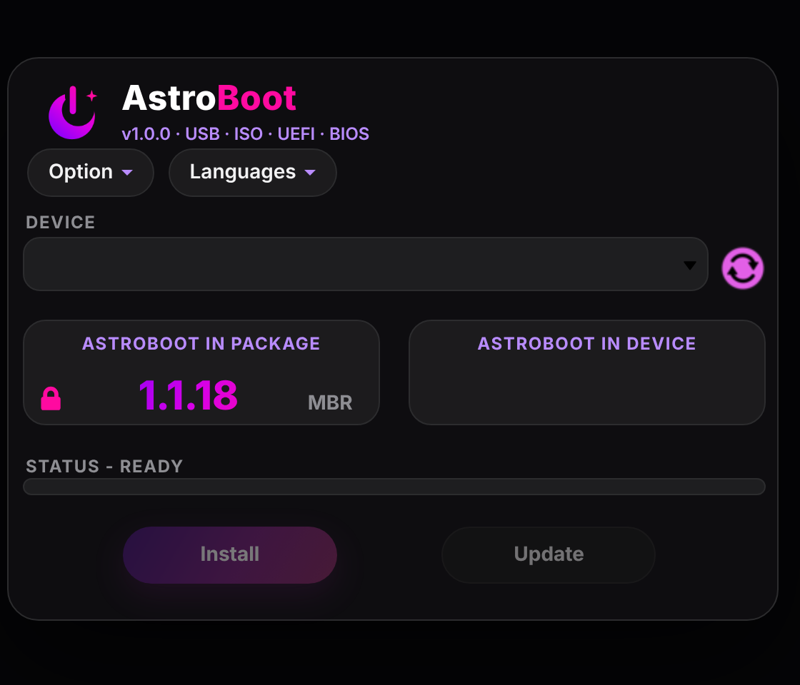

<p align="center"></p>

<p align="center"></p>

# AstroBoot

> **Un solo USB para arrancarlo todo.** Copia tus ISO y elige cuál arrancar. Sin formatear cada vez, sin herramientas extra.

AstroBoot es el arrancador USB de la familia **Astro**: la luna con el símbolo de encendido. Es un fork de [Ventoy](https://github.com/ventoy/Ventoy) de longpanda, distribuido bajo **GPL-3.0** (ver `COPYING`, `License/` y [`THIRD_PARTY_NOTICES.md`](THIRD_PARTY_NOTICES.md)). El README original se conserva en [`DOC/UPSTREAM_README.md`](DOC/UPSTREAM_README.md).

## Descargar

Ve a **[Releases](https://github.com/AstroSoftwareMoon/AstroBoot/releases/latest)**:

| Sistema | Archivo | Cómo usarlo |
|---|---|---|
| Windows | `astroboot-1.0.0-windows.zip` | Descomprime y ejecuta `AstroBoot2Disk.exe` |
| Linux | `astroboot-1.0.0-linux.tar.gz` | `sudo sh AstroBootWeb.sh` (interfaz web) o `sudo sh AstroBoot2Disk.sh -i /dev/sdX` |

Después, copia tus archivos `.iso`, `.wim`, `.img`, `.vhd(x)` o `.efi` a la partición **AstroBoot** del USB, en las carpetas que quieras.

## En imágenes

<p align="center"></p>

<p align="center">
  
  
  
  
  
  
</p>

### Instaladores

<p align="center">
  
  
  
</p>

<p align="center"><sub>Windows (<code>AstroBoot2Disk.exe</code>, captura del CI en Windows Server 2022) · Linux GTK (<code>AstroBootGUI.x86_64</code>) · Linux web (<code>AstroBootWeb.sh</code>)</sub></p>

> Capturas reales tomadas arrancando el USB de AstroBoot en QEMU (UEFI y BIOS). Los nombres de ISO del menú son archivos de ejemplo; `memtest86+x64.iso` es una ISO real que arranca.

## Cambios respecto a Ventoy

**Aspecto**
- Tema nuevo al estilo de AstroTune: fondo espacial negro con brillos violeta y rosa, panel de cristal, selección en píldora con degradado `#7a00ff → #d900e6 → #ff0aa0`, barra de desplazamiento rosa y fuentes DejaVu Sans.
- 52 iconos propios: tipo de imagen (ISO, WIM, IMG, VHD, EFI, carpeta) y cada herramienta.
- Logo y nombre AstroBoot en el menú, la ayuda, los instaladores y los mensajes.
- **Instalador de Windows rediseñado y recompilado** desde el código fuente con MSVC: ventana oscura, cabecera con el logo, tarjetas, botón Instalar con degradado, barra de progreso magenta, menús oscuros, fuente Segoe UI e icono AstroBoot (también en `AstroBootPlugson.exe` y `AstroBootVlnk.exe`).
- Instaladores de Linux con el mismo estilo: la GUI GTK usa un tema CSS AstroBoot (`astroboot/gtk/`) e iconos nuevos, y el instalador web está rediseñado en modo oscuro.

**Más herramientas** (al final del menú principal y dentro de **F5**)
- **Test de memoria RAM** con Memtest86+ 7 (BIOS y UEFI x64).
- **Arrancar desde Internet** con netboot.xyz: decenas de sistemas e instaladores sin descargar ISO.
- **Buscar sistemas operativos instalados**: encuentra Windows, GRUB, shim, systemd-boot y rEFInd en los discos del PC y los arranca.
- **Información del sistema**: CPU, modo 32/64 bits, RAM, fabricante, Secure Boot, discos y particiones, dispositivos PCI.
- **Modos de vídeo**, **reiniciar**, **apagar** y **entrar en la configuración UEFI**.
- **Acerca de AstroBoot**.

**Idioma**
- Menú en español por defecto (pulsa **L** para cambiarlo; o `VTOY_MENU_LANGUAGE` en `ventoy.json`).
- Textos nuevos traducidos a español, inglés, portugués, francés, alemán e italiano.

**Otros**
- Scripts renombrados: `AstroBoot2Disk.sh`, `AstroBootWeb.sh`, `AstroBootPlugson.sh`, `AstroBootVlnk.sh`, `AstroBootGUI.*`, `AstroBoot2Disk.exe`.
- La partición de datos se llama `AstroBoot` al instalar desde Linux.
- Corregido `sr_RS.json` del menú, al que le faltaba la llave inicial.

## Teclas del menú

| Tecla | Acción |
|---|---|
| **L** | Idioma |
| **F1** | Ayuda |
| **F2** | Explorar discos y arrancar cualquier archivo |
| **F3** | Vista de lista / árbol |
| **F4** | Arrancar el disco local (Windows, GRUB…) |
| **F5** | Herramientas (incluye Herramientas AstroBoot) |
| **F6** | Menú personalizado (`ventoy/ventoy_grub.cfg`) |

## Compatibilidad

AstroBoot usa el núcleo de arranque de Ventoy 1.1.18 tal cual, así que arranca lo mismo que Ventoy: más de 1000 ISO probadas, BIOS (Legacy), UEFI x86_64 / IA32 / ARM64, **Secure Boot**, MBR y GPT, exFAT / NTFS / FAT32 / ext4, persistencia, instalación automática y todos los plugins de `ventoy.json`.

- **Actualizar** un USB que ya tiene Ventoy convierte el USB en AstroBoot **sin borrar tus ISO**.
- Memtest86+ y netboot.xyz no están firmados: con Secure Boot activo puede que el firmware los rechace.
- El número que muestran los instaladores (1.1.18) es la versión del núcleo de arranque.

### ¿Por qué sigue apareciendo "ventoy" en algunos sitios?

Solo donde es obligatorio para que funcione:
- La partición de arranque se llama `VTOYEFI` y la carpeta de configuración del USB `ventoy/` (con `ventoy.json`). El núcleo las busca por ese nombre.
- La línea pequeña de créditos de la esquina ("`1.1.18 UEFI  www.ventoy.net`") la dibuja el binario GRUB **firmado**. Quitarla exige recompilar GRUB y perder la firma de Secure Boot, así que AstroBoot la deja como crédito, solo que más discreta y con sus colores.
- Los instaladores muestran "1.1.18": es la versión del núcleo de arranque. Abajo a la izquierda de AstroBoot2Disk.exe hay un enlace "Based on Ventoy" como crédito.
- Las GUI de Linux (GTK/Qt) son los binarios oficiales, compilados para distros antiguas; AstroBoot sustituye sus iconos dentro del binario y les aplica su tema, sin recompilarlos.

## Compilar

```bash
sudo apt install mtools dosfstools xz-utils zip unzip
bash astroboot/build.sh
```

Los paquetes quedan en `astroboot/out/`. El script descarga la release oficial de Ventoy 1.1.18, comprueba su SHA-256, toma de ella los binarios firmados y reconstruye la partición `VTOYEFI` con el menú, el tema, las traducciones, los scripts y las herramientas de este repositorio.

GitHub Actions compila en cada push y, al subir una etiqueta `v*`, publica la release con los paquetes y `SHA256SUMS.txt`.

| Ruta | Contenido |
|---|---|
| `INSTALL/grub/astroboot.cfg` | Menú Herramientas AstroBoot |
| `INSTALL/grub/themes/astroboot/` | Tema GRUB (generado con `astroboot/branding/make_theme.py`) |
| `INSTALL/grub/grub.cfg` | Configuración principal (versión, tema, idioma, créditos) |
| `LinuxGUI/WebUI/static/css/astroboot.css` | Estilo del instalador web |
| `astroboot/tools/` | Memtest86+ y netboot.xyz |
| `astroboot/scripts/rebrand_menu_lang.py` | Traducciones y cambio de marca del menú |

El código fuente completo de Ventoy (GRUB2, EDK2, iPXE, instaladores…) está en el repositorio. El método de compilación completo original sigue en [`DOC/BuildVentoyFromSource.txt`](DOC/BuildVentoyFromSource.txt).

## Licencia

GPL-3.0, igual que Ventoy. Cada componente conserva su licencia (ver `License/` y `THIRD_PARTY_NOTICES.md`).
